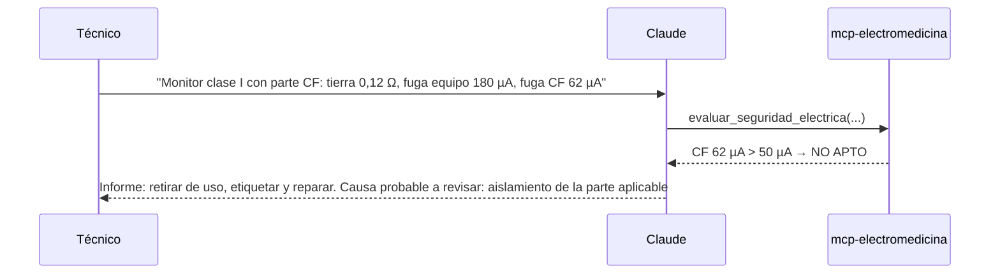

<div align="center">

# ⚡ mcp-electromedicina

**Servidor MCP que da a Claude herramientas de ingeniería clínica: seguridad eléctrica según IEC 62353 y planificación del mantenimiento preventivo.**


</div>

---

## Por qué

En un servicio de electromedicina, cada ensayo de seguridad eléctrica acaba en una hoja: mediciones, límites de la norma, veredicto. Un modelo de lenguaje puede ayudar a redactar el informe y a priorizar el trabajo, pero **no debería «recordar» los límites de una norma**: puede equivocarse.

Este servidor [MCP](https://modelcontextprotocol.io) resuelve eso. Claude llama a herramientas deterministas y probadas que aplican la norma, y se limita a explicar el resultado y a preparar la documentación.



## Herramientas

| Herramienta | Qué hace |
|---|---|
| `evaluar_seguridad_electrica` | Compara la resistencia de tierra y las corrientes de fuga (del equipo y de la parte aplicable B/BF/CF) con los límites de IEC 62353, según la clase I/II y el método directo, diferencial o alternativo. Avisa si falta una medición obligatoria. |
| `limites_iec_62353` | Devuelve la tabla de límites que usa el servidor, para que sea auditable. |
| `puntuar_fennigkoh_smith` | Calcula la puntuación EM del método de Fennigkoh y Smith (función + riesgo + mantenimiento + historial) y decide si el equipo entra en el programa de preventivo (EM ≥ 12). |
| `planificar_preventivos` | A partir de un inventario, lista los preventivos vencidos y los próximos, ordenados por urgencia. |

### Límites de referencia (IEC 62353:2014)

| Ensayo | Clase I | Clase II | BF | CF |
|---|---:|---:|---:|---:|
| Resistencia del conductor de protección | 0,3 Ω | — | | |
| Fuga del equipo, método directo o diferencial | 500 µA | 100 µA | | |
| Fuga del equipo, método alternativo | 1000 µA | 500 µA | | |
| Fuga de la parte aplicable | | | 5000 µA | 50 µA |

> [!WARNING]
> Herramienta de apoyo para personal técnico cualificado. Comprueba siempre la edición vigente de la norma y las instrucciones del fabricante. Un veredicto «APTO» del software no sustituye la firma del técnico responsable.

## Instalación

No necesita dependencias: solo Python 3.9 o superior.

```bash
git clone https://github.com/raulhernandezherce/mcp-electromedicina.git
```

**Claude Code** (desde la carpeta del repositorio):

```bash
claude mcp add electromedicina -- python3 -m mcp_electromedicina
```

**Claude Desktop**: añade esto a `claude_desktop_config.json`:

```json
{
  "mcpServers": {
    "electromedicina": {
      "command": "python3",
      "args": ["-m", "mcp_electromedicina"],
      "cwd": "/ruta/a/mcp-electromedicina"
    }
  }
}
```

Prueba a pedirle: *«Planifica los preventivos de [examples/inventario.json](examples/inventario.json) para las próximas 8 semanas»*.

## Cómo está hecho

- **Protocolo MCP implementado a mano**: JSON-RPC 2.0 por stdio, con negociación de versión (`2025-06-18`, `2025-03-26`, `2024-11-05`), `tools/list`, `tools/call` con `structuredContent` y errores bien formados. Sin SDK, para entender el protocolo de verdad y para que funcione en cualquier Python 3.9+.
- **La lógica no sabe nada de MCP**: `seguridad.py` y `mantenimiento.py` son funciones puras y testeadas. El servidor solo traduce.
- **Robusto**: un JSON roto o unos argumentos erróneos devuelven un error, pero no tumban el servidor. Los registros van a stderr para no contaminar el canal del protocolo.

```
mcp_electromedicina/seguridad.py      límites IEC 62353 y evaluación
mcp_electromedicina/mantenimiento.py  Fennigkoh-Smith y planificación
mcp_electromedicina/servidor.py       servidor MCP (stdio, JSON-RPC 2.0)
tests/                                tests unitarios y de protocolo extremo a extremo
```

```bash
python3 -m unittest discover -s tests -t . -v
```

## Ideas para seguir

- Exportar el informe del ensayo a PDF con los datos del analizador.
- Leer directamente los ficheros de analizadores de seguridad eléctrica comerciales.
- Añadir los límites de IEC 60601-1 para los ensayos de tipo.

---

<sub>Hecho por <a href="https://github.com/raulhernandezherce">Raúl Hernández Herce</a> · Técnico Superior en Electromedicina Clínica · Licencia MIT</sub>
